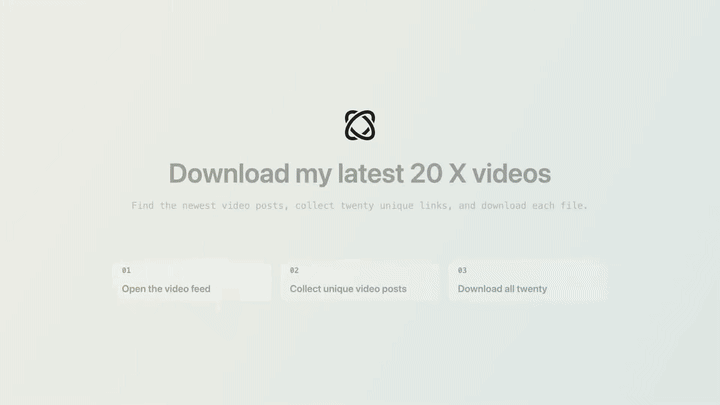
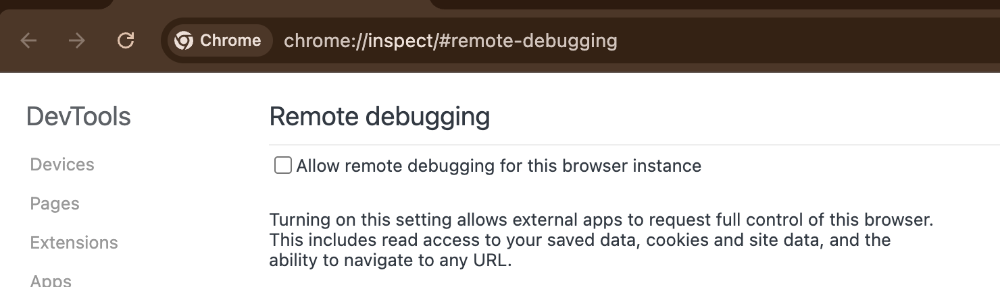

# Browser Harness ♞

Browser Harness lets Claude Code, Codex or Cursor use your real Chrome browser: open pages, click, type, read and download, logged in as you. Paste one prompt into your coding agent to set it up. It talks to Chrome over the DevTools Protocol (CDP), and the agent writes any missing helper as it works, so the harness gets better with each task. Open source, MIT licensed.

Try browser-harness in [Browser Use Cloud](https://cloud.browser-use.com/v4?utm_campaign=browser-harness-use-in-cloud&utm_source=github) or paste the setup prompt into your coding agent.

```
  ● agent: wants to upload a file
  │
  ● agent-workspace/agent_helpers.py → helper missing
  │
  ● agent writes it                         agent_helpers.py
  │                                                       + custom helper
  ✓ file uploaded
```

**You will never use the browser again.**

## See it work

**Task:** "Open my X profile, find my latest 20 video posts, and download them."

[](https://browser-use.com/showcase/videos/download-latest-20-x-videos.mp4)

## Setup prompt

Paste into Claude Code or Codex (Cursor: use the [MCP config](#cursor) below):

```text
Install or upgrade browser-harness to the latest stable version with uv using Python 3.12, register the skill from `browser-harness skill`, and connect it to my browser. Ask whether I want local browser recordings enabled; default to no and preserve my existing preference on upgrades. Follow https://github.com/browser-use/browser-harness/blob/main/install.md if setup or connection fails.
```

The agent will open `chrome://inspect/#remote-debugging`. On first setup, tick
the checkbox so the agent can connect to your browser:



## How it works

- [`install.md`](install.md) connects the agent to your browser.
- [`SKILL.md`](SKILL.md) teaches it the browser workflow.
- [`src/browser_harness/`](src/browser_harness/) stays protected while the agent writes reusable helpers in its local workspace.

## Compared with other browser tools

| | Works with | Browser it drives | What you approve in your own Chrome |
|---|---|---|---|
| **Browser Harness** | Claude Code, Codex, Cursor, any MCP client via `browser-harness-mcp` | Your running Chrome, logged in as you | Whole browser: on Chrome 144+, tick remote debugging in `chrome://inspect`, then click Allow |
| **Playwright MCP** | Any MCP client (Claude Code, Codex, Cursor, Copilot and more) | Its own browser profile by default. Your Chrome with `--extension` (Playwright Extension) or `--cdp-endpoint` | Chosen tabs (one tab group per client) via the extension, approval skippable with a token; or whole browser via `--cdp-endpoint` |
| **Playwright CLI** | Claude Code, GitHub Copilot and other agents that run shell commands | Its own browser by default. Your Chrome with `attach --extension=chrome` or `attach --cdp=chrome` | Chosen tab via the Playwright Extension, or whole browser via `--cdp` |
| **Chrome DevTools MCP** | Any MCP client (Claude Code, Cursor, Copilot, Antigravity and more), plus a CLI | A new Chrome with a dedicated profile by default. Your Chrome 144+ with `--autoConnect` | Whole browser: the same Chrome 144+ toggle and Allow dialog; the server sees every open window of that profile |
| **agent-browser** | Claude Code, Codex, Cursor, Gemini CLI, Copilot and more, as a CLI with a skill, plus an MCP server | Its own Chrome for Testing by default. A copy of your Chrome profile with `--profile`. Your running Chrome with `--auto-connect` or `--cdp` | Whole browser via `--auto-connect` or `--cdp`: the same Chrome 144+ toggle and Allow dialog |
| **Claude in Chrome** | Claude Code (CLI or VS Code) with the Claude extension, signed in with a direct Anthropic plan (Pro, Max, Team, Enterprise), not an API key | Your Chrome, Edge or other Chromium browser, logged in as you | Per site: allow sites in the extension, or per action in Claude Code (auto mode can skip the per-site check). Claude works in a tab group it opens |
| **ChatGPT Browser and browser extension** | Codex and ChatGPT chats in the ChatGPT desktop app, not Codex CLI or the Codex IDE extension | Browser: a separate profile. Extension: your Chrome, Edge, Brave, Opera or Vivaldi profile | Per site: asks before each new website (allow once, for this site, or for all sites) |

Matched eval by Browser Use on 100 of the 200 public [BU Bench V2.1](https://github.com/browser-use/benchmark) tasks (bu2-001 to bu2-100; 101-200 not run). Measured 2026-10-14.

- Same agent for every tool: Codex CLI 0.144.6, GPT-6 Luna, medium reasoning, web search off. Same frozen judge.
- Browser Harness was given to the agent as its CLI and SKILL.md, not `browser-harness-mcp`. Playwright MCP and Chrome DevTools MCP ran as MCP servers with default settings. agent-browser ran as its CLI and skill.
- Every tool drove the same fresh Browser Use cloud browser over CDP. This does not measure each tool's default or local-Chrome mode.
- One run per task. Agent failures were never retried. Runner, browser and judge failures were rerun once (Browser Harness 3 tasks, Playwright MCP 4, Chrome DevTools MCP 6, agent-browser 0).

| Tool | Mean rubric score 0-100 (95% CI) | Fully solved | Median input tokens per task | Median model cost per task (GPT-6 Luna list price) | Median agent time per task |
|---|---|---|---|---|---|
| Browser Harness a6426f84 (main) | 60.4 (55.2-65.4) | 11% | 2.1M | $0.042 | 9.0 min |
| Playwright MCP 0.0.83 | 60.0 (55.1-65.0) | 11% | 4.4M | $0.066 | 8.3 min |
| Chrome DevTools MCP 1.10.1 | 61.0 (55.8-65.9) | 11% | 6.7M | $0.097 | 8.7 min |
| agent-browser 0.39.1 | 56.3 (51.1-61.5) | 9% | 3.3M | $0.056 | 11.2 min |

No tool wins on score: every paired difference against Browser Harness has a 95% CI that includes zero (other tool minus Browser Harness: agent-browser -4.0, CI -10.0 to +1.8; Playwright MCP -0.4, -6.6 to +5.7; Chrome DevTools MCP +0.6, -5.6 to +6.6).

Browser Harness had the lowest median input tokens (2.1M vs 3.3-6.7M) and the lowest median model cost ($0.042 vs $0.056-0.097). Model cost excludes browser, proxy and judge. It was slower than Playwright MCP and Chrome DevTools MCP (median 9.0 vs 8.3 and 8.7 min) and faster than agent-browser (11.2 min). These are medians, with no confidence intervals.

A first agent-browser run was discarded: a setup bug on our side let it launch its own local browser instead of the shared cloud browser. The row shows the corrected rerun.

Measured with Codex only. Claude Code, Cursor, Playwright CLI and Claude in Chrome were not measured. Method and per-task scores: [coding-agent-browser-tools.json](https://browser-use.com/benchmarks/coding-agent-browser-tools.json).

### When to use something else

- **Playwright** (Test, MCP or CLI): isolated, repeatable CI tests of your own app, in a clean browser with no personal logins.
- **Chrome DevTools MCP**: performance traces and DevTools debugging (network, console, source-mapped stack traces).
- **Claude in Chrome**: you only use Claude and have a Pro, Max, Team or Enterprise plan.
- **Cursor's built-in Browser**: the agent doesn't need your logged-in Chrome. It runs in its own per-workspace profile.

OpenAI's Codex labels its browser feature "Browser use" in its settings. It is separate from Browser Use, the company behind this repo.

## Scale with Browser Use Cloud

Use your local browser for logged-in, personal work. When you want many browsers in parallel, with live previews, proxies, stealth, CAPTCHA solving, and more, scale with [Browser Use Cloud](https://cloud.browser-use.com/new-api-key).

## MCP server

`browser-harness-mcp` exposes the browser control helpers as MCP tools over
stdio, so any MCP client (Claude Code, Devin, Cursor, etc.) can drive the
browser without writing a second CDP layer. See [docs/MCP.md](docs/MCP.md) for
setup and client configuration.

### Cursor

Add this to `.cursor/mcp.json` in your project, or to `~/.cursor/mcp.json` for
every project. It needs [uv](https://docs.astral.sh/uv/).

```json
{
  "mcpServers": {
    "browser-harness": {
      "type": "stdio",
      "command": "uvx",
      "args": ["--from", "browser-harness[mcp]", "browser-harness-mcp"]
    }
  }
}
```

## Contributing

Bug fixes, documentation improvements, and agent-generated domain skills are welcome. See [CONTRIBUTING.md](CONTRIBUTING.md).

---

[The Bitter Lesson of Agent Harnesses](https://browser-use.com/posts/bitter-lesson-agent-harnesses) · [Web Agents That Actually Learn](https://browser-use.com/posts/web-agents-that-actually-learn)
