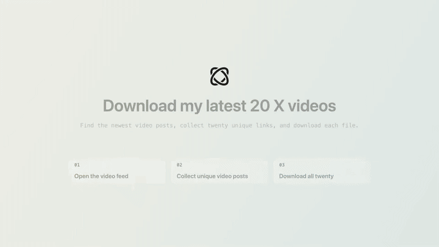
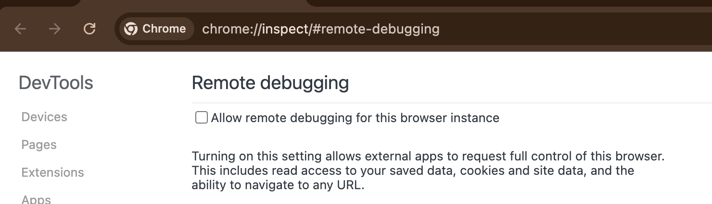

<p align="center"><a href="README.md">English</a> · Türkçe</p>

> [!NOTE]
> **Browser Harness artık [Browser Use](https://github.com/browser-use/browser-use)'un içindeki motor.** `browser-use` CLI'ını kullan: aynı yardımcılar ve arka plan servisi (daemon), artı `browser-use login`, bir MCP sunucusu (`browser-use --cli-mcp`) ve `browser-use skill install`.
>
> ```bash
> uv tool install browser-use
> browser-use <<'PY'
> new_tab("https://example.com")
> print(page_info())
> PY
> ```
>
> `browser-harness` komutu çalışmaya devam ediyor. Alan becerileri (domain skills) ve etkileşim becerileri bu repoda kalıyor.

# Browser Harness ♞

Browser Harness; Claude Code, Codex veya Cursor'ın senin gerçek Chrome tarayıcını kullanmasını sağlar: sayfa açar, tıklar, yazar, okur ve indirir; hepsini senin oturumunla. Kurmak için kodlama ajanına tek bir istem (prompt) yapıştırman yeter. Chrome ile DevTools Protocol (CDP) üzerinden konuşur ve ajan çalışırken eksik olan her yardımcı fonksiyonu kendisi yazar; böylece harness her görevde biraz daha gelişir. Açık kaynak, MIT lisanslı.

browser-harness'ı [Browser Use Cloud](https://cloud.browser-use.com/v4?utm_campaign=browser-harness-use-in-cloud&utm_source=github)'da dene ya da kurulum istemini kodlama ajanına yapıştır.

```
  ● agent: wants to upload a file
  │
  ● agent-workspace/agent_helpers.py → helper missing
  │
  ● agent writes it                         agent_helpers.py
  │                                                       + custom helper
  ✓ file uploaded
```

**Tarayıcıyı bir daha hiç kendin kullanmayacaksın.**

## Çalışırken gör

**Görev:** "X profilimi aç, en son 20 video gönderimi bul ve indir."

[](https://browser-use.com/showcase/videos/download-latest-20-x-videos.mp4)

## Kurulum istemi

Claude Code'a veya Codex'e yapıştır (Cursor için aşağıdaki [MCP yapılandırmasını](#cursor) kullan):

```text
Install browser-use with `uv tool install browser-use`, run `browser-use skill install` to register the skill, and connect it to my browser. If setup or connection fails, run `browser-use --doctor` and follow its output and the error message.
```

Ajan `chrome://inspect/#remote-debugging` sayfasını açar. İlk kurulumda, ajanın
tarayıcına bağlanabilmesi için kutucuğu işaretle:



## Nasıl çalışır

- [`install.md`](install.md) ajanı tarayıcına bağlar.
- [`SKILL.md`](SKILL.md) ajana tarayıcı iş akışını öğretir.
- [`src/browser_harness/`](src/browser_harness/) korunur; ajan yeniden kullanılabilir yardımcılarını kendi yerel çalışma alanına yazar.

## Diğer tarayıcı araçlarıyla karşılaştırma

| | Çalıştığı araçlar | Kontrol ettiği tarayıcı | Kendi Chrome'unda neyi onaylıyorsun |
|---|---|---|---|
| **Browser Harness** | Claude Code, Codex, Cursor, `browser-harness-mcp` ile her MCP istemcisi | Çalışan Chrome'un, senin oturumunla | Tarayıcının tamamı: Chrome 144+'da `chrome://inspect` içinde uzaktan hata ayıklamayı işaretle, sonra Allow'a tıkla |
| **Playwright MCP** | Her MCP istemcisi (Claude Code, Codex, Cursor, Copilot ve diğerleri) | Varsayılan olarak kendi tarayıcı profili. `--extension` (Playwright Extension) veya `--cdp-endpoint` ile senin Chrome'un | Eklenti ile seçilen sekmeler (istemci başına bir sekme grubu; onay bir token ile atlanabilir) ya da `--cdp-endpoint` ile tarayıcının tamamı |
| **Playwright CLI** | Claude Code, GitHub Copilot ve kabuk komutu çalıştıran diğer ajanlar | Varsayılan olarak kendi tarayıcısı. `attach --extension=chrome` veya `attach --cdp=chrome` ile senin Chrome'un | Playwright Extension ile seçilen sekme ya da `--cdp` ile tarayıcının tamamı |
| **Chrome DevTools MCP** | Her MCP istemcisi (Claude Code, Cursor, Copilot, Antigravity ve diğerleri), artı bir CLI | Varsayılan olarak ayrı profilli yeni bir Chrome. `--autoConnect` ile senin Chrome 144+'ın | Tarayıcının tamamı: aynı Chrome 144+ anahtarı ve Allow penceresi; sunucu o profilin tüm açık pencerelerini görür |
| **agent-browser** | Claude Code, Codex, Cursor, Gemini CLI, Copilot ve diğerleri; beceriyle birlikte bir CLI, artı bir MCP sunucusu | Varsayılan olarak kendi Chrome for Testing'i. `--profile` ile Chrome profilinin bir kopyası. `--auto-connect` veya `--cdp` ile çalışan Chrome'un | `--auto-connect` veya `--cdp` ile tarayıcının tamamı: aynı Chrome 144+ anahtarı ve Allow penceresi |
| **Claude in Chrome** | Claude eklentisiyle Claude Code (CLI veya VS Code); API anahtarıyla değil, doğrudan bir Anthropic planıyla (Pro, Max, Team, Enterprise) giriş yapılmış | Chrome, Edge veya başka bir Chromium tarayıcın, senin oturumunla | Site bazında: siteleri eklentide izinli yap ya da Claude Code'da eylem bazında onayla (otomatik mod site bazlı kontrolü atlayabilir). Claude, açtığı bir sekme grubunda çalışır |
| **ChatGPT Browser ve tarayıcı eklentisi** | ChatGPT masaüstü uygulamasındaki Codex ve ChatGPT sohbetleri; Codex CLI veya Codex IDE eklentisi değil | Tarayıcı: ayrı bir profil. Eklenti: Chrome, Edge, Brave, Opera veya Vivaldi profilin | Site bazında: her yeni siteden önce sorar (bir kez, bu site için ya da tüm siteler için izin ver) |

Browser Use tarafından, herkese açık 200 [BU Bench V2.1](https://github.com/browser-use/benchmark) görevinin 100'ü üzerinde yapılmış eşleştirilmiş değerlendirme (bu2-001 - bu2-100; 101-200 çalıştırılmadı). Ölçüm tarihi: 2026-10-14.

- Her araç için aynı ajan: Codex CLI 0.144.6, GPT-6 Luna, orta akıl yürütme, web araması kapalı. Aynı sabit hakem (judge).
- Browser Harness ajana `browser-harness-mcp` olarak değil, CLI'ı ve SKILL.md'si olarak verildi. Playwright MCP ve Chrome DevTools MCP varsayılan ayarlarla MCP sunucusu olarak çalıştı. agent-browser, CLI'ı ve becerisiyle çalıştı.
- Her araç, CDP üzerinden aynı taze Browser Use bulut tarayıcısını kontrol etti. Bu, her aracın varsayılan ya da yerel Chrome modunu ölçmez.
- Görev başına tek çalıştırma. Ajan başarısızlıkları hiç yeniden denenmedi. Çalıştırıcı, tarayıcı ve hakem kaynaklı hatalar bir kez yeniden çalıştırıldı (Browser Harness 3 görev, Playwright MCP 4, Chrome DevTools MCP 6, agent-browser 0).

| Araç | Ortalama puan 0-100 (%95 GA) | Tamamen çözülen | Görev başına ortanca girdi token'ı | Görev başına ortanca model maliyeti (GPT-6 Luna liste fiyatı) | Görev başına ortanca ajan süresi |
|---|---|---|---|---|---|
| Browser Harness a6426f84 (main) | 60,4 (55,2-65,4) | %11 | 2,1M | $0.042 | 9,0 dk |
| Playwright MCP 0.0.83 | 60,0 (55,1-65,0) | %11 | 4,4M | $0.066 | 8,3 dk |
| Chrome DevTools MCP 1.10.1 | 61,0 (55,8-65,9) | %11 | 6,7M | $0.097 | 8,7 dk |
| agent-browser 0.39.1 | 56,3 (51,1-61,5) | %9 | 3,3M | $0.056 | 11,2 dk |

Puanda kazanan araç yok: Browser Harness'a karşı her eşleştirilmiş farkın %95 güven aralığı sıfırı içeriyor (diğer araç eksi Browser Harness: agent-browser -4,0, GA -10,0 ile +1,8; Playwright MCP -0,4, -6,6 ile +5,7; Chrome DevTools MCP +0,6, -5,6 ile +6,6).

Browser Harness en düşük ortanca girdi token'ına (2,1M; diğerleri 3,3-6,7M) ve en düşük ortanca model maliyetine ($0.042; diğerleri $0.056-0.097) sahipti. Model maliyetine tarayıcı, proxy ve hakem dahil değil. Playwright MCP ve Chrome DevTools MCP'den daha yavaştı (ortanca 9,0 dk; onlar 8,3 ve 8,7 dk), agent-browser'dan ise daha hızlıydı (11,2 dk). Bunlar ortancadır, güven aralıkları yoktur.

İlk agent-browser çalıştırması iptal edildi: bizim taraftaki bir kurulum hatası, paylaşılan bulut tarayıcısı yerine kendi yerel tarayıcısını başlatmasına yol açtı. Tablodaki satır düzeltilmiş yeniden çalıştırmayı gösteriyor.

Yalnızca Codex ile ölçüldü. Claude Code, Cursor, Playwright CLI ve Claude in Chrome ölçülmedi. Yöntem ve görev bazlı puanlar: [coding-agent-browser-tools.json](https://browser-use.com/benchmarks/coding-agent-browser-tools.json).

### Ne zaman başka bir şey kullanmalı

- **Playwright** (Test, MCP veya CLI): kendi uygulamanın, kişisel oturum içermeyen temiz bir tarayıcıda, izole ve tekrarlanabilir CI testleri.
- **Chrome DevTools MCP**: performans izleri ve DevTools ile hata ayıklama (ağ, konsol, source map'li hata yığınları).
- **Claude in Chrome**: yalnızca Claude kullanıyorsan ve Pro, Max, Team veya Enterprise planın varsa.
- **Cursor'ın yerleşik Browser'ı**: ajanın giriş yapılmış Chrome'una ihtiyacı yoksa. Çalışma alanı başına kendi profilinde çalışır.

OpenAI'ın Codex'i, ayarlarındaki tarayıcı özelliğine "Browser use" diyor. Bu, bu reponun arkasındaki şirket olan Browser Use'tan ayrı bir şeydir.

## Browser Use Cloud ile ölçeklen

Giriş yapılmış, kişisel işler için yerel tarayıcını kullan. Canlı önizleme, proxy, gizlilik (stealth), CAPTCHA çözme ve daha fazlasıyla çok sayıda tarayıcıyı paralel çalıştırmak istediğinde [Browser Use Cloud](https://cloud.browser-use.com/new-api-key) ile ölçeklen.

## MCP sunucusu

`browser-use --cli-mcp`, tarayıcı kontrol yardımcılarını stdio üzerinden MCP
araçları olarak sunar; böylece herhangi bir MCP istemcisi (Claude Code, Devin, Cursor vb.)
ikinci bir CDP katmanı yazmadan tarayıcıyı kontrol edebilir. Eski `browser-harness-mcp`
çalışmaya devam ediyor; bkz. [docs/MCP.md](docs/MCP.md).

### Cursor

Bunu projendeki `.cursor/mcp.json` dosyasına ya da her proje için `~/.cursor/mcp.json`
dosyasına ekle. [uv](https://docs.astral.sh/uv/) gerekir.

```json
{
  "mcpServers": {
    "browser-use": {
      "type": "stdio",
      "command": "uvx",
      "args": ["browser-use", "--cli-mcp"]
    }
  }
}
```

## Katkıda bulunma

Hata düzeltmeleri, belge iyileştirmeleri ve ajan tarafından üretilmiş alan becerileri memnuniyetle karşılanır. Bkz. [CONTRIBUTING.md](CONTRIBUTING.md).

---

[The Bitter Lesson of Agent Harnesses](https://browser-use.com/posts/bitter-lesson-agent-harnesses) · [Web Agents That Actually Learn](https://browser-use.com/posts/web-agents-that-actually-learn)
